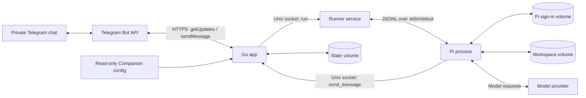

# Companion architecture

Companion is a single-user service for one private Telegram chat. The Go app saves chat requests and delivers replies. Pi runs one model step at a time in a separate container. It uses its native tools in a durable workspace. The Go app does not mount that workspace or handle file operations.

See [README.md](README.md) for setup and [GLOSSARY.md](GLOSSARY.md) for terms.

## 1. Components and deployment

| Component | Responsibility | Source |
| --- | --- | --- |
| App entry point | Validate configuration and supervise the service loops. | [`main.go`](main.go), [`config.go`](config.go) |
| Telegram client | Poll for text updates from the configured private chat. Send plain-text replies. | [`internal/telegram`](internal/telegram) |
| Engine | Handle commands, save state, select work, build prompts, and drain the outbox. | [`internal/engine`](internal/engine) |
| Pi bridge | Start one Pi RPC process per step and pass message tool calls to the app. | [`internal/pi`](internal/pi) |

[Compose](compose.yaml) runs two services with separate filesystems and a shared socket volume. The runner listens on `/run/companion/runner.sock`. The app and runner connect over Unix sockets, not TCP. Neither service publishes a port. The app can stay up when you replace an idle runner.

The [Dockerfile](Dockerfile) builds the app and runner service with Go `1.27.4` and installs Pi `1.6.1` in the runner. Both services run as UID/GID `1000:1000`, with read-only container roots, all Linux capabilities dropped, `no-new-privileges`, and no Docker socket.

| Data | Standard location | Access and lifetime |
| --- | --- | --- |
| Companion configuration | `/etc/companion/companion.json` | Read-only app bind mount. Contains the provider and model IDs, optional thinking level, Telegram bot token, and private chat ID. |
| App state | `/app/state` | App-only named volume. Contains `state.json` and `state.lock`. |
| Durable workspace | `/workspace` | Runner-only named `workspace` volume. The agent can change files without approval. Files survive container replacement. |
| Pi sign-in | `/home/node/.pi/agent` | Runner-only external volume `companion-pi-auth`. Pi tools can read it. |
| Bridge sockets | `/run/companion` | Shared `sockets` volume. Holds the runner listener and the current message callback socket. |

## 2. Startup and process lifecycle

1. Load `model`, `provider` (default `openai`), optional `thinking-level`, `tg-bot-token`, and `tg-chat-id` from the JSON config. If `thinking-level` is absent, use `medium`. If it is `null`, let Pi choose the level. The app limits the config to 4 KiB, validates provider, model, and token formats, and requires a positive chat ID. It requires an HTTP(S) Telegram URL without credentials, a query string, or a fragment. See [Application settings](#application-settings) for the environment variables.
2. Create the state directory if necessary, acquire an exclusive `flock` on `state.lock`, and load the snapshot. A second app cannot open the same state directory while this lock is held. The app does not request a Pi process until a step needs a model.
3. Start three loops. Telegram `Poll` accepts updates. Engine `Work` runs one model step at a time. Engine `Deliver` sends queued messages. The engine mutex serializes state changes. The loops do not hold it during network calls. Wake channels and timers let the loops wait for state changes or deadlines.

On `SIGINT` or `SIGTERM`, or when a loop exits, the supervisor cancels the shared context. It waits up to 15 seconds. Compose gives the app 30 seconds to stop. The worker stops taking requests and cancels the active model step. Cancellation does not undo changes to the workspace.

## 3. Durable state and commit boundary

The app uses one versioned JSON snapshot, not a database or a Pi session. [`state.go`](internal/engine/state.go) defines version `4` and validates the snapshot at load time. The app rejects older versions.

| Record | Contents |
| --- | --- |
| Telegram cursor | Next update ID and time of the last saved update. |
| Pending requests | Text for each request that does not have a saved outcome. |
| Conversation history | User text and the assistant reply, if any, for each finished request. |
| Outbox and incidents | Queued text, confirmed text byte position, send-in-progress marker, retry time, and records of failed or uncertain deliveries. |

For each commit, the engine changes state under its mutex. It writes the snapshot to a temporary file in the state directory, syncs and closes the file, renames it to `state.json`, and syncs the directory. Only then does it publish the new Telegram cursor. A save error stops the engine and cancels the active step. The app does not acknowledge an update on the basis of a failed save.

A snapshot commit can include an update and all its state changes. It cannot include a Telegram send or a native tool action in the same transaction.

### Edit old development state

Stop the app and make a private backup of `state.json`. Edit only the working copy. For version `3` state:

1. Remove `message_id` from each item in `pending`.
2. Remove entries with an `emoji` from `outbox` and `delivery_incidents` (for an incident, check its `delivery` object). Keep text deliveries and their send state.
3. Keep the Telegram cursor and history. Set `version` to `4`. Start the app again and check `/status`.

## 4. Telegram input and command routing

1. The Telegram client calls `getUpdates` with the saved offset, a 25-second long-poll timeout, and a batch limit of 25. It sorts updates by ID and skips non-positive IDs and IDs below the current cursor.
2. It only passes text to the engine when `chat.id` matches the configured ID and `chat.type` is `private`. Other updates can advance the cursor but cannot create work.
3. The engine saves `update_id + 1` with the changes and replies from the update. The next poll uses that offset to acknowledge earlier updates. After six days without a saved update, the engine requests offset `0` because Telegram can start a new ID sequence.

The app adds plain text to the pending queue. It handles slash commands locally:

| Input | Effect |
| --- | --- |
| `/help` | List commands. |
| `/status` | Report whether the worker is active and how many requests are waiting. |

The Telegram client uses a 40-second HTTP timeout and does not follow redirects. It hides transport error details that could contain the bot token. Polling retries transient errors and HTTP 409 with delays from 1 to 30 seconds, unless Telegram supplies a longer delay. Other permanent poll errors stop the service.

## 5. Request queue and memory

The worker runs requests in the order it receives them. The active request stays at the head of the saved queue. Each step has a five-minute timeout. At the end of a step, one commit removes the request and saves the conversation turn with all model messages queued during that step, in order. If the model fails, times out, or sends no messages, the same commit queues an error message. Messages already queued stay in the outbox until delivery handles them. The worker then takes the next request. It does not retry a model error automatically.

Each prompt includes the current request and up to 20 earlier conversation records.

Pi receives system instructions to consult and maintain notes in `/workspace/notes` on its own initiative. It uses one Markdown file per topic with descriptive names and headings. It also reads, saves, changes, or removes notes when asked in ordinary conversation. The runner reads and writes these files with its native tools. The app does not inject the files into prompts. Removing a note does not erase conversation history.

## 6. Pi step and message bridge

The [Pi client](internal/pi/bridge.go) creates a callback socket for the step and sends the prompt to the runner. The runner starts a fresh `pi --mode rpc --no-session` process, checks the selected provider and model, then sends `prompt`. A successful `prompt` response is not completion. The runner waits for `agent_settled`, then stops the process. If the app disconnects, the runner cancels the process. Cancellation does not undo tool actions.

The `send_message` extension posts each message back to the app on the step callback socket. The app accepts messages only while that step is active. See the [runner contract](internal/pi/README.md) for the protocol and failure cases.

## 7. Workspace access

Pi starts in `/workspace`. Its tools can create, edit, rename, and delete workspace files and make network requests. The app does not keep a log of each file operation.

Companion does not add a tool sandbox inside the runner. Pi and its tools can read the runner's model credentials and reach the shared sockets. A shell command can use the socket directly. The runner does not mount the app's Telegram token, state, or host directories. Run only work you trust and back up files that the agent must not lose.

## 8. Telegram output and delivery

The model uses `send_message` for all text it wants the user to see, including the complete answer. Each call adds a separate message to the saved outbox. The tool returns `queued` after the save. It does not wait for Telegram. The model can send multiple messages in one turn. There is no separate path for progress or final text. The app does not forward ordinary assistant text or stream partial text.

The outbox is first-in, first-out. The delivery loop splits messages at up to 4,096 UTF-16 code units without splitting a Unicode code point. It sends plain text with link previews disabled.

Before each text part, the loop saves `sending`. A Telegram message ID confirms that Telegram accepted the text. It does not confirm that the user saw it. The engine advances the confirmed text byte position or removes the completed entry. On a definite temporary rejection, it saves an exponential retry delay of up to one minute, unless Telegram supplies a longer delay. A delayed entry holds its place in the queue.

On a permanent rejection or an unknown result, the engine records a delivery incident and replaces the rest of the entry with a notice. A disconnect, a timeout, or a restart with `sending` still set can make the result unknown. The engine does not resend the uncertain text part. If the notice also fails permanently or has an unknown result, the engine records the failure without generating a second notice. If you missed a reply, ask Companion to repeat it.

## 9. Shutdown and recovery

| Saved condition | Recovery behavior |
| --- | --- |
| An update and its effects were committed | Resume polling from the saved cursor. |
| A request is still pending | Start a new ephemeral step. Messages already queued can still reach the user. They do not prevent the new step from sending the same text again. The prompt tells the agent to check the workspace before it repeats work. |
| A text part was marked `sending` | Record an uncertain delivery and queue a notice. Resume other deliveries from their confirmed positions and saved retry times. |

The app does not provide exactly-once execution for model turns, native tools, or Telegram delivery. The state-volume lock prevents two engines from writing one snapshot. It does not coordinate separate deployments.

## 10. Operating limits and verification

- Use one app instance, one private chat, one Telegram poller, and one worker. There is no database server or state replication.
- Each commit rewrites the snapshot. The app removes finished requests from the pending queue. It does not prune history or delivery incidents. It sends up to 20 conversation records per prompt.
- Stop both services before backing up state and workspace. Protect both backups as private data. `docker compose down` keeps named volumes. `docker compose down -v` removes app state and workspace but not the external sign-in volume.

Run `go test -race ./...` for tests of configuration, Telegram HTTP behavior, request queues, state, delivery, and the Pi bridge. Run [`tests/run.sh`](tests/run.sh) for a Docker test with real Pi, a local model fixture, and a fake Telegram API. It checks progress, final delivery, restart recovery, and workspace persistence. It uses disposable volumes and does not contact Telegram or a live model provider.

## Application settings

| Environment variable | Default outside Compose | Compose setting |
| --- | --- | --- |
| `COMPANION_CONFIG` | `companion.json` | `/etc/companion/companion.json`; change the host source with `COMPANION_CONFIG_SOURCE` |
| `COMPANION_STATE_DIR` | `./state` | `/app/state` |
| `COMPANION_SOCKET_DIR` | `/run/companion` | Same in both containers; use a short path to fit Unix socket limits |
| `COMPANION_TELEGRAM_URL` | `https://api.telegram.org` | Same; override only for a trusted fixture |
