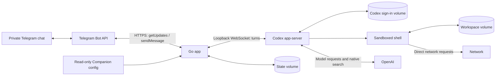

# Companion architecture

Companion is a single-user service for one private Telegram chat. The Go app saves chat requests and delivers replies. Codex runs one model step at a time in a separate container. It uses its native tools in a durable workspace. The Go app does not mount that workspace or handle file operations.

See [README.md](README.md) for setup and [GLOSSARY.md](GLOSSARY.md) for terms.

## 1. Components and deployment

| Component | Responsibility | Source |
| --- | --- | --- |
| App entry point | Validate configuration and supervise the service loops. | [`main.go`](main.go), [`config.go`](config.go) |
| Telegram client | Poll for text updates from the configured private chat. Send plain-text replies. | [`internal/telegram`](internal/telegram) |
| Engine | Handle commands, save state, select work, build prompts, and drain the outbox. | [`internal/engine`](internal/engine) |
| Codex client | Run one ephemeral app-server turn and return the final text. | [`internal/codex`](internal/codex) |

[Compose](compose.yaml) runs two services with separate filesystems. The app joins the runner's network namespace to reach `ws://127.0.0.1:4500`. Neither service publishes a port. The runner joins a Docker bridge with egress, which also lets the app reach Telegram. If you replace the runner, recreate the app so that it joins the new network namespace.

The [Dockerfile](Dockerfile) builds the Go `1.27.4` app and installs Codex CLI `0.172.0` and Bubblewrap in the runner. Both services run as UID/GID `1000:1000`, with read-only container roots, all Linux capabilities dropped, `no-new-privileges`, and no Docker socket. The runner uses the repository's [seccomp profile](docker/codex-seccomp.json), based on [Moby profiles at `a0fa708`](https://github.com/moby/profiles/blob/a0fa70805f742f7da15b367770d802ea2a86c68b/seccomp/default.json). Its additions let Bubblewrap create nested namespaces and set up their mount tree. The runner does not use privileged mode or unconfined seccomp. See [the upstream license](docker/MOBY-LICENSE).

| Data | Standard location | Access and lifetime |
| --- | --- | --- |
| Companion configuration | `/etc/companion/companion.json` | Read-only app bind mount. Contains the model ID, optional thinking level, Telegram bot token, and private chat ID. |
| App state | `/app/state` | App-only named volume. Contains `state.json` and `state.lock`. |
| Durable workspace | `/workspace` | Runner-only named `workspace` volume. The agent can change files without approval. Files survive container replacement. |
| Codex sign-in | `/home/node/.codex` | Runner-only external volume `companion-codex-auth`. The shell cannot read it. |

## 2. Startup and process lifecycle

1. Load `model`, optional `thinking-level`, `tg-bot-token`, and `tg-chat-id` from the JSON config. If `thinking-level` is absent, use `medium`. If it is `null`, let Codex choose the level. The app limits the config to 4 KiB, validates the model and token formats, and requires a positive chat ID. It checks endpoint schemes and rejects credentials, query strings, and fragments in the URLs. See [Application settings](#application-settings) for the environment variables.
2. Create the state directory if necessary, acquire an exclusive `flock` on `state.lock`, and load the snapshot. A second app cannot open the same state directory while this lock is held. The app does not contact Codex until a step needs a model.
3. Start three loops. Telegram `Poll` accepts updates. Engine `Work` runs one model step at a time. Engine `Deliver` sends queued messages. The engine mutex serializes state changes. The loops do not hold it during network calls. Wake channels and timers let the loops wait for state changes or deadlines.

On `SIGINT` or `SIGTERM`, or when a loop exits, the supervisor cancels the shared context. It waits up to 15 seconds. Compose gives the app 30 seconds to stop. The worker stops taking requests and cancels the active model step. Cancellation does not undo changes to the workspace.

## 3. Durable state and commit boundary

The app uses one versioned JSON snapshot, not a database or a Codex session. [`state.go`](internal/engine/state.go) defines version `4` and validates the snapshot at load time. The app rejects older versions.

| Record | Contents |
| --- | --- |
| Telegram cursor | Next update ID and time of the last saved update. |
| Pending requests | Text for each request that does not have a saved outcome. |
| Conversation history | User text and the assistant reply, if any, for each finished request. |
| Outbox and incidents | Queued text, confirmed text byte position, send-in-progress marker, retry time, and records of failed or uncertain deliveries. |

For each commit, the engine changes state under its mutex. It writes the snapshot to a temporary file in the state directory, syncs and closes the file, renames it to `state.json`, and syncs the directory. Only then does it publish the new Telegram cursor. A save error stops the engine and cancels the active step. The app does not acknowledge an update on the basis of a failed save.

A snapshot commit can include an update and all its state changes. It cannot include a Telegram send or a native tool action in the same transaction.

### Edit old development state

Stop the app and make a private backup of `state.json`. Edit only the working copy. For version `3` state:

1. Remove `message_id` from each item in `pending`.
2. Remove entries with an `emoji` from `outbox` and `delivery_incidents` (for an incident, check its `delivery` object). Keep text deliveries and their send state.
3. Keep the Telegram cursor and history. Set `version` to `4`. Start the app again and check `/status`.

## 4. Telegram input and command routing

1. The Telegram client calls `getUpdates` with the saved offset, a 25-second long-poll timeout, and a batch limit of 25. It sorts updates by ID and skips non-positive IDs and IDs below the current cursor.
2. It only passes text to the engine when `chat.id` matches the configured ID and `chat.type` is `private`. Other updates can advance the cursor but cannot create work.
3. The engine saves `update_id + 1` with the changes and replies from the update. The next poll uses that offset to acknowledge earlier updates. After six days without a saved update, the engine requests offset `0` because Telegram can start a new ID sequence.

The app adds plain text to the pending queue. It handles slash commands locally:

| Input | Effect |
| --- | --- |
| `/help` | List commands. |
| `/status` | Report whether the worker is active and how many requests are waiting. |

The Telegram client uses a 40-second HTTP timeout and does not follow redirects. It hides transport error details that could contain the bot token. Polling retries transient errors and HTTP 409 with delays from 1 to 30 seconds, unless Telegram supplies a longer delay. Other permanent poll errors stop the service.

## 5. Request queue and memory

The worker runs requests in the order it receives them. The active request stays at the head of the saved queue. Each step has a five-minute timeout. On success, one commit removes the request, saves the conversation turn, and adds the reply to the outbox. A model error or timeout removes the request, saves the user text without an assistant reply, and queues an error message. The worker then takes the next request. It does not retry a model error automatically.

Each prompt includes the current request and up to 20 earlier conversation records.

Codex receives developer instructions to consult and maintain notes in `/workspace/notes` on its own initiative. It uses one Markdown file per topic with descriptive names and headings. It also reads, saves, changes, or removes notes when asked in ordinary conversation. The runner reads and writes these files with its native tools. The app does not inject the files into prompts. Removing a note does not erase conversation history.

## 6. Codex step and protocol boundary

The [Codex client](internal/codex/client.go) opens one WebSocket per step. It sends `initialize` and `initialized`, checks Linux and `CODEX_HOME`, and looks for the exact configured model in the OpenAI `model/list` catalog. It requests a fresh ephemeral `thread/start` with provider fallback disabled. It checks the reported model, local environment, workspace roots, permission profile, approval policy, and that the shell has network access before sending `turn/start`.

The client uses JSON-RPC over WebSocket text messages. It sends one client request at a time and buffers a limited set of early turn notifications until it knows the turn ID. App-server runs native tools directly. The client rejects all server requests, including approval requests.

The client returns the final assistant text, or the last assistant message if app-server did not mark a final answer. The client does not stream partial text to Telegram.

The client rejects model changes and reroutes. It does not retry turns or select a fallback model. On cancellation or an early error with a known turn ID, it attempts `turn/interrupt` for up to one second. Neither an interrupt nor a WebSocket close proves that a native tool stopped. See the [runner contract](internal/codex/README.md) for protocol and account limits.

## 7. Workspace boundary

The agent's working directory and shell home are `/workspace`. It can use native tools to create, edit, rename, and delete its files. There is no file broker, Telegram file approval, or external alias. The app does not keep a log of each file operation.

The `companion-workspace` profile gives the shell network access, read access to minimal runtime files, and write access to `/workspace`. The profile does not expose the sign-in files directly, and the shell does not inherit the app-server environment. Network access lets the shell reach the unauthenticated loopback WebSocket and send requests directly to Codex without Companion’s checks. Codex treats the workspace project as untrusted. Keep app credentials, app state, host directories, and sockets out of the workspace. Back up files that the agent must not lose.

The shell boundary does not control app-server network requests. Native live web search can send queries and turn context to OpenAI. Account-side apps and plugins can operate outside the shell sandbox if they do not require client approval. Use an account without those integrations if they must not be available.

## 8. Telegram output and delivery

The prompt asks the model to send one short commentary message when it expects the work to take time. For the active step, the engine queues that message in the outbox and lets the same turn continue. There is no timer for progress text. The update does not enter conversation history.

The outbox is first-in, first-out. The delivery loop splits messages at up to 4,096 UTF-16 code units without splitting a Unicode code point. It sends plain text with link previews disabled.

Before each text part, the loop saves `sending`. A Telegram message ID confirms that Telegram accepted the text. It does not confirm that the user saw it. The engine advances the confirmed text byte position or removes the completed entry. On a definite temporary rejection, it saves an exponential retry delay of up to one minute, unless Telegram supplies a longer delay. A delayed entry holds its place in the queue.

On a permanent rejection or an unknown result, the engine records a delivery incident and replaces the rest of the entry with a notice. A disconnect, a timeout, or a restart with `sending` still set can make the result unknown. The engine does not resend the uncertain text part. If the notice also fails permanently or has an unknown result, the engine records the failure without generating a second notice. If you missed a reply, ask Companion to repeat it.

## 9. Shutdown and recovery

| Saved condition | Recovery behavior |
| --- | --- |
| An update and its effects were committed | Resume polling from the saved cursor. |
| A request is still pending | Start a new ephemeral step. Partial output is not a checkpoint. The prompt tells the agent to check the workspace before it repeats work. |
| A text part was marked `sending` | Record an uncertain delivery and queue a notice. Resume other deliveries from their confirmed positions and saved retry times. |

The app does not provide exactly-once execution for model turns, native tools, or Telegram delivery. The state-volume lock prevents two engines from writing one snapshot. It does not coordinate separate deployments.

## 10. Operating limits and verification

- Use one app instance, one private chat, one Telegram poller, and one worker. There is no database server or state replication.
- Each commit rewrites the snapshot. The app removes finished requests from the pending queue. It does not prune history or delivery incidents. It sends up to 20 conversation records per prompt.
- Stop both services before backing up state and workspace. Protect both backups as private data. `docker compose down` keeps named volumes. `docker compose down -v` removes app state and workspace but not the external sign-in volume.

Run `go test -race ./...` for tests of configuration, Telegram HTTP behavior, request queues, state, delivery, and the Codex protocol. Run [`tests/run.sh`](tests/run.sh) for the app image with fake Telegram and Codex peers. Run [`tests/runner.sh`](tests/runner.sh) for native file operations, workspace persistence, and shell boundary checks with real Codex and a local model fixture. Both Docker tests use disposable volumes and do not contact Telegram or OpenAI.

## Application settings

| Environment variable | Default outside Compose | Compose setting |
| --- | --- | --- |
| `COMPANION_CONFIG` | `companion.json` | `/etc/companion/companion.json`; change the host source with `COMPANION_CONFIG_SOURCE` |
| `COMPANION_STATE_DIR` | `./state` | `/app/state` |
| `COMPANION_CODEX_URL` | `ws://127.0.0.1:4500` | Same |
| `COMPANION_TELEGRAM_URL` | `https://api.telegram.org` | Same; override only for a trusted fixture |
